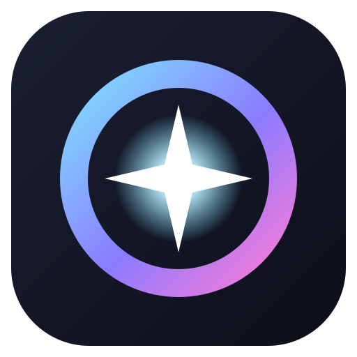

<p align="center"></p>

<h1 align="center">DaevaLens</h1>

<p align="center">Multi-overlay combat meter and fight analysis for <b>AION 2</b> — Windows and Linux.<br>
<a href="README.es.md">Leer en español</a></p>

---

DaevaLens shows what is happening in your fights in small overlays you place anywhere on top of the game, and keeps every fight for later analysis.

It only **reads the network traffic the game receives**. It never touches the game client, never reads its memory and never automates anything.

## Built on A2Tools DPS Meter

The hard part of any AION 2 meter — capturing the traffic and decoding the game's protocol — is the work of **[A2Tools DPS Meter](https://github.com/taengu/A2Tools-DPS-Meter)** by **taengu** and contributors. DaevaLens uses its parser, capture and combat storage **unmodified**, as a git submodule (`upstream/`), so protocol fixes after each game patch arrive by updating the submodule. Everything on top of it — fights, overlays, tracker, history and analysis — is DaevaLens.

Both projects are licensed under the **GNU GPL v3**. If you only want a damage meter, use A2Tools DPS Meter: it is excellent.

## Features

**Overlays** — each one its own window, turned on and styled independently, moved and resized in edit mode:

| Overlay | Shows |
|---|---|
| DPS | Your DPS and your group's, a bar per player; your row is always visible |
| Target | Target health and estimated time to kill |
| Tracker | Buffs on you and debuffs you put on your target: up or down, stacks, uptime |
| Skills | Your damage per skill in the current fight |
| Summary | A card with the numbers of the fight that just ended |
| Alerts | A big alert (and sound) when a tracked debuff drops or someone dies |
| Status | Connection, ping and fight time |
| Upcoming | Countdown to the events you follow: rifts, sieges, world bosses |

**Fights that make sense** — a fight starts with your first hit and ends after a few seconds without damage from you or your group (configurable). Only damage on the enemies you hit counts, so strangers nearby do not inflate the numbers.

**History and analysis** — every fight is saved: DPS over time, damage per skill (crit, back attack, best hit), summon damage, buff/debuff uptime and every player.

**Event alerts** — rifts, Artifact Siege, post-siege bosses, Watcher Kaira, Guardian Lord Nahma, Shugo Festival, Dimensional Invasion and resets, on the global servers' calendar (UTC or your region's server clock). Pick which to follow and get an alert a few minutes before. Every time is editable — community sources disagree on some — and you can add your own.

**Class presets** — the tracker fills itself for your class the first time it sees you (Spiritmaster: Element Unification stacks, Corrode, Curse, Spirit's Benediction, Flame Blessing). Add anything else you see from the panel.

**Starts with the game** — optionally start at login in the background; overlays appear when AION 2 starts and hide when it closes. On Hyprland they also move to the game's workspace.

## Install

### Windows

1. Install **[Npcap](https://npcap.com/#download)** (free; the same driver Wireshark uses).
2. Download the installer from [Releases](../../releases) and run it.

### Linux

The game runs under Proton; DaevaLens runs natively next to it.

- **Debian / Ubuntu / Mint / Pop!_OS:** `sudo apt install ./DaevaLens_*.deb`
- **Fedora / openSUSE:** `sudo dnf install ./DaevaLens-*.rpm`
- **Arch / CachyOS / Manjaro / EndeavourOS:** `cd packaging/arch && makepkg -si`

The packages give the program the one permission it needs to read packets (`CAP_NET_RAW`), so it never runs as root. If you build it yourself:

```bash
sudo setcap cap_net_raw=ep /path/to/daevalens
```

The tray icon needs `libayatana-appindicator`; without it DaevaLens runs normally without a tray.

### Wayland compositors

Wayland does not let an app keep itself above a fullscreen game, so on Wayland DaevaLens runs through XWayland. Tiling compositors need to be told to float the overlays.

**Hyprland** (Lua config):

```lua
hl.window_rule({
    match = { class = "^([Dd]aeva[Ll]ens)$", title = "^(DaevaLens (dps|target|tracker|skills|summary|alerts|info|events))$" },
    float = true, no_initial_focus = true, no_blur = true, no_shadow = true, border_size = 0, rounding = 0,
})
hl.window_rule({ match = { class = "^([Dd]aeva[Ll]ens)$", title = "^(DaevaLens)$" }, float = true, center = true })
```

**Hyprland** (classic config; rule names vary between versions, see the [wiki](https://wiki.hypr.land/Configuring/Window-Rules/)):

```ini
windowrule = float, noinitialfocus, noblur, noshadow, noborder, rounding 0, class:^([Dd]aeva[Ll]ens)$, title:^(DaevaLens (dps|target|tracker|skills|summary|alerts|info|events))$
windowrule = float, center, class:^([Dd]aeva[Ll]ens)$, title:^(DaevaLens)$
```

**Starting with your session:** "Start when I log in" uses the standard XDG autostart (`~/.config/autostart`). Hyprland, Sway and i3 only run it through `uwsm`, `dex` or similar; otherwise add `daevalens --background` to your own autostart (`hl.exec_cmd(...)` inside `hyprland.start`, `exec-once`, `exec`).

**Sway / i3:** `for_window [class="Daevalens"] floating enable, sticky enable, border none`

## Shortcuts

Bind these commands to keys in your desktop, or use the tray menu:

```text
daevalens --panel            open the control panel
daevalens --edit             toggle edit mode (move/resize overlays)
daevalens --toggle <widget>  show/hide: dps target tracker skills summary alerts info events
daevalens --reset            clear the current fight
```

## Build from source

Needs Rust (1.85+), Node.js and, on Linux, the WebKitGTK 4.1, libpcap and appindicator development packages.

```bash
git clone --recursive https://github.com/Yeetlex/DaevaLens
cd daevalens
mkdir -p upstream/dist   # upstream's crate expects its web build folder
npm ci
npx tauri build          # or: npx tauri dev
```

To work on the UI without the game, `npm run preview` and open <http://localhost:8766/dev/preview.html>: every overlay at its real size with demanding fake data.

## Is it allowed?

DaevaLens is passive: it reads packets the game already receives, the same way any network tool does. It is not endorsed by NCSOFT, and using third-party tools is at your own risk. Never use anything that automates play.

## Support

If it helps you and you want to buy me a coffee, donations are welcome in ETH (Ethereum mainnet):

```text
0x334B54cE55d40A87919b4066102279D70865b1ae
```

## License

GPL-3.0-only. AION 2 is a trademark of NCSOFT; this project is not affiliated with NCSOFT. Game names and icons are loaded from the game's public data and CDN.
